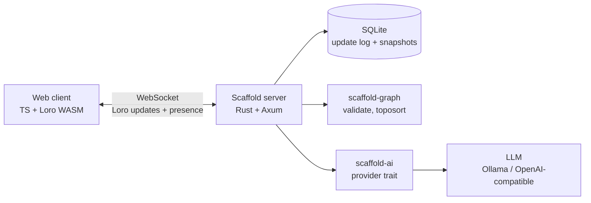

# Scaffold

**A local-first, multiplayer canvas of typed nodes and edges that compiles into a validated, dependency-ordered implementation plan.**

> Status: **pre-alpha.** M0 skeleton and M1 in-memory sync are built. See [`docs/ROADMAP.md`](docs/ROADMAP.md) for milestones.

Sketch a system on a shared canvas: features, services, risks, tasks, and the dependencies between them. Edit with teammates in real time, or alone on a bad connection; everything merges when you reconnect. Then press **Extract** and Scaffold turns the graph into an ordered task plan.

## The idea in one paragraph

Most whiteboard AI looks at a screenshot or a blob of flattened text and free-writes a plan. Scaffold doesn't. The canvas is a **structured graph**, and the graph is the ground truth. The LLM is only allowed to do the fuzzy work (break a node into subtasks, write descriptions, estimate effort). Everything structural is done by deterministic Rust code: cycle detection, topological ordering, and checking that every task the model mentions maps to a real node. The model proposes; the graph disposes.

## Features (planned)

**Core**
- Infinite canvas with typed nodes (`Feature`, `Service`, `Task`, `Risk`, `Note`) and typed edges (`depends_on`, `part_of`, `calls`)
- Real-time multiplayer sync built on [Loro](https://loro.dev) CRDTs
- Offline editing with automatic merge on reconnect
- Live presence: cursors, selections, names
- **Extract:** canvas → validated, ordered task plan, delivered as a proposal you accept or reject
- Named snapshots of a room

**Stretch**
- Markdown and GitHub Issues export
- Share links with view/edit roles
- Comments pinned to nodes
- "Explain this architecture" for a selected subgraph

## How it works



Each room is one Loro document. Clients keep a local copy (IndexedDB), so editing never waits on the network. The server holds the authoritative merged copy, persists it, and runs Extract. Details in [`docs/ARCHITECTURE.md`](docs/ARCHITECTURE.md).

## Repository layout

```
server/        Axum app: WebSocket sync, persistence, HTTP API
graph/         Pure Rust crate: data model, validation, toposort (no I/O)
ai/            Provider trait, prompts, JSON schemas, output validation
client/        Web UI (TypeScript)
tests/         Simulation and integration tests
docs/          Design documents
AGENTS.md      Rules for AI coding agents working in this repo
```

## Documentation

| Doc | What it covers |
|---|---|
| [`docs/ARCHITECTURE.md`](docs/ARCHITECTURE.md) | Components, sync protocol, persistence |
| [`docs/DATA_MODEL.md`](docs/DATA_MODEL.md) | Node/edge schema, Loro layout, invariants |
| [`docs/EXTRACT.md`](docs/EXTRACT.md) | The Extract pipeline and AI contract |
| [`docs/TESTING.md`](docs/TESTING.md) | Convergence, partition, and AI-validation testing |
| [`docs/ROADMAP.md`](docs/ROADMAP.md) | Milestones with acceptance criteria |
| [`docs/DECISIONS.md`](docs/DECISIONS.md) | Architecture decision records |
| [`AGENTS.md`](AGENTS.md) | Working agreement for coding agents |
| [`CONTRIBUTING.md`](CONTRIBUTING.md) | How to contribute |

## Non-goals

Rich text inside nodes, freehand drawing, performance work beyond a few hundred nodes, auth beyond share links, and any paid hosted infrastructure.

## Development

Prerequisites: stable Rust, Node.js, and npm.

Start the server in one terminal:

```sh
cargo run -p scaffold-server
```

Start the client in another terminal:

```sh
cd scaffold-client
npm install
npm run dev
```

Open the Vite URL in two tabs, leave both on `demo-room`, and create or drag nodes to see live updates. The room document is held in server memory and is lost on restart until M2 persistence.

## License

MIT (add a `LICENSE` file before the first public release).
