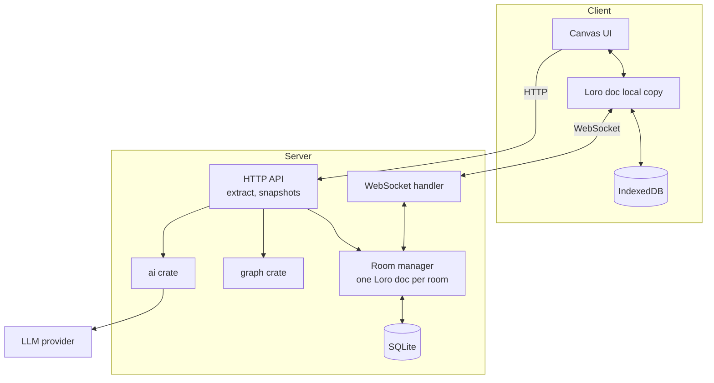

# Architecture

## Overview

Scaffold has three runtime pieces: a **web client**, a **sync server**, and an **LLM provider**. Pure logic lives in two library crates so it can be tested without any I/O.

## Crates and packages

| Path | Role | Depends on |
|---|---|---|
| `graph/` | Data model, canonical serialization, cycle detection, toposort. No I/O. | none (plus `loro` only if needed for reading a doc) |
| `ai/` | `LlmProvider` trait, prompt builders, JSON schemas, output validation. | `graph` |
| `server/` | Axum app: WebSocket sync, persistence, HTTP API. | `graph`, `ai` |
| `client/` | TypeScript web UI. | `loro-crdt` (WASM) |

## Local-first model

- Every client holds a complete local copy of the room's Loro document and applies edits to it immediately. The UI never waits on the network.
- The local copy is persisted in IndexedDB, so a reload while offline still shows the latest state.
- On (re)connect, client and server exchange what the other is missing and merge. Because Loro is a CRDT, merge is order-independent and conflict-free by construction.
- The server is a peer with extra jobs (persistence, extraction, relay). It is not a lock or an arbiter.

## Sync protocol (v0 draft)

Binary WebSocket frames. First byte is the message type.

| Type | Direction | Payload |
|---|---|---|
| `0x01 Hello` | C → S | room id, protocol version, client version vector |
| `0x02 SyncReply` | S → C | updates the client is missing, plus server version vector |
| `0x03 Update` | both | Loro update bytes (incremental) |
| `0x04 Presence` | both | ephemeral presence payload (cursor, selection, name, color) |
| `0x05 Error` | S → C | code + message |

Flow:
1. Client connects to `/ws/:room_id` and sends `Hello` with its version vector.
2. Server replies with `SyncReply` containing everything the client lacks, and its own version vector.
3. Client sends any updates the server lacks as `Update`.
4. From then on, local edits are broadcast as `Update`; the server applies, persists, and relays to other clients in the room.
5. Presence is relayed but **never persisted**.

> Verify the exact Loro export/import calls (`export` modes, version vectors vs frontiers, ephemeral state support) against the pinned version's docs. This table defines Scaffold's framing, not Loro's API. If Loro's built-in ephemeral/presence support is sufficient, use it for `Presence`; otherwise relay presence as plain messages.

## Persistence

SQLite via `sqlx`.

| Table | Contents |
|---|---|
| `rooms` | `id`, `name`, `created_at` |
| `updates` | `room_id`, `seq`, `bytes`, `created_at` (append-only log of incoming updates) |
| `snapshots` | `room_id`, `id`, `label`, `bytes`, `created_at` (compacted state or named versions) |

- On startup (or first room access), the server loads the latest compacted snapshot, then replays newer `updates`.
- **Compaction:** after N updates or T seconds idle, export a full snapshot, store it, and delete the updates it covers. Compaction must be atomic (one transaction).
- **Named snapshots** are user-visible versions ("before refactor") and are never auto-deleted.

## HTTP API (v0 draft)

| Method | Path | Purpose |
|---|---|---|
| `POST` | `/api/rooms` | Create a room |
| `GET` | `/api/rooms/:id` | Room metadata |
| `POST` | `/api/rooms/:id/extract` | Run Extract, return a proposal |
| `GET` | `/api/rooms/:id/snapshots` | List named snapshots |
| `POST` | `/api/rooms/:id/snapshots` | Create a named snapshot |
| `POST` | `/api/rooms/:id/snapshots/:sid/restore` | Restore a snapshot |
| `GET` | `/api/rooms/:id/export.md` | Markdown export of the latest accepted plan |

Accepting a proposal is done **client-side** as ordinary CRDT edits (so it merges like any other edit), not by a special server write.

## Presence

Ephemeral per-connection state: display name, color, cursor position, selected node ids. Dropped on disconnect, with a timeout so ghosts disappear. Never written to the document or the database.

## Error handling

- Typed errors per crate (`thiserror`). The server maps them to HTTP status codes and WS `Error` frames.
- Malformed or oversized updates are rejected and the connection is closed with a reason.
- Extract failures return structured errors (cycle found, provider unavailable, invalid model output) rather than generic 500s.

## Security (scope-limited)

- Share links carry an unguessable room token. Roles (view/edit) are enforced by the server dropping `Update` frames from view-only connections.
- Secrets (LLM keys) come from environment variables and are never sent to the client.
- Rate-limit Extract per room to bound LLM cost.

## Scale assumptions

Hundreds of nodes per room, a handful of concurrent editors, a single server process. Horizontal scaling is out of scope.
